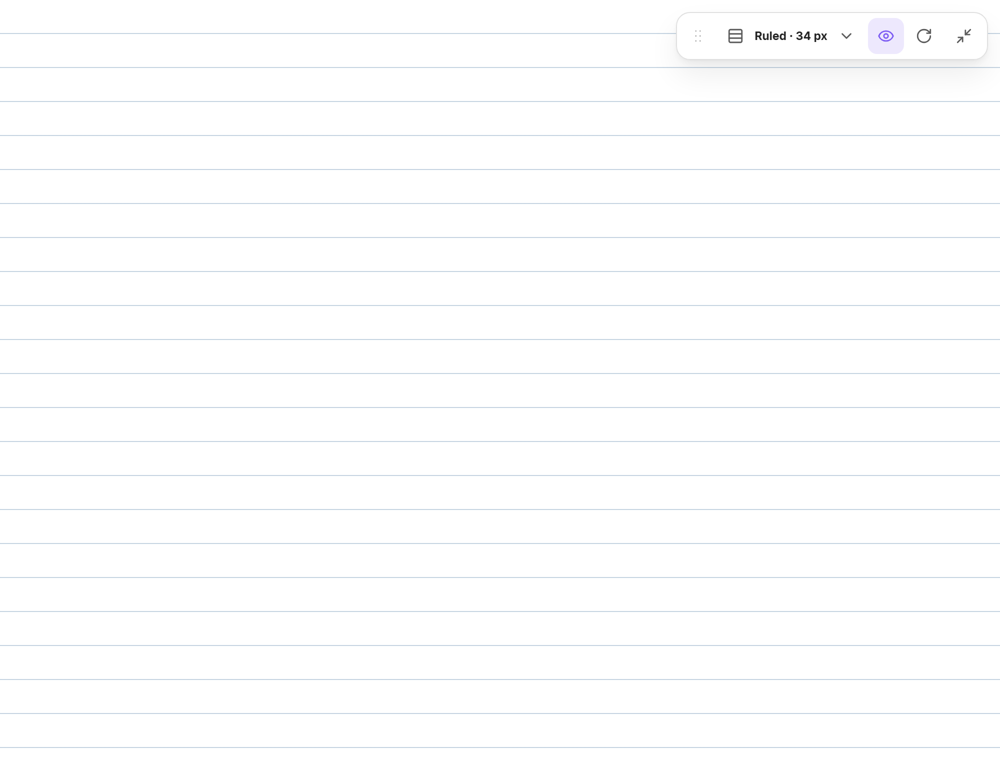
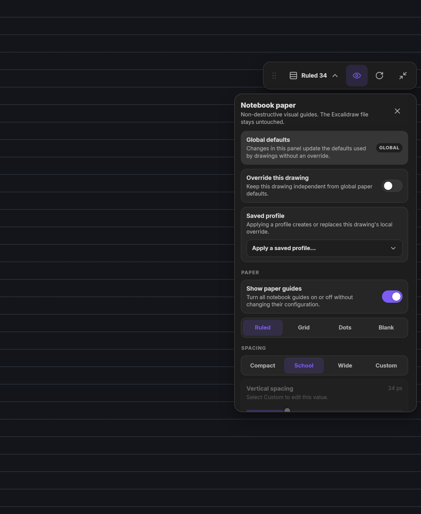
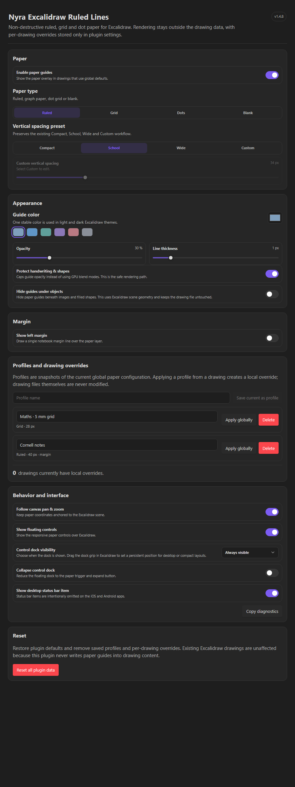

# Nyra Excalidraw Ruled Lines

Notebook paper for Excalidraw in Obsidian: **ruled, grid, dot or blank**, drawn behind your strokes without ever changing the drawing file. A small draggable dock gives you quick control on desktop, iPad and phone.

<p align="center">
  
  
</p>

## Features

- **Four paper modes:** Ruled, Grid, Dots and Blank, with Compact / School / Wide / Custom spacing, linked or independent grid axes, line thickness, opacity and colour.
- **Optional notebook margin** with its own position, thickness and colour, in every paper mode.
- **Non-destructive.** The guides are an overlay. Your `.excalidraw.md` files are never written to; overrides live in the plugin's settings.
- **Global defaults, per-drawing overrides and named profiles.** Save "Maths · 5 mm grid" once and apply it to any drawing.
- **Object-aware masking (optional):** hide guides beneath images, embeds and filled shapes.
- **Draggable, persistent dock.** Place it anywhere in the pane; the position is remembered separately for desktop and touch layouts and adapts to split panes and rotation. Collapse it to three buttons.
- **Built for touch.** Large targets, sliders that never fight vertical scrolling, VisualViewport and safe-area handling, reduced-motion support.
- **Light and dark** follow your Obsidian theme and accent colour.
- **Event-driven.** No polling timers; pan and zoom are rendered imperatively without React re-renders.

## Install

**With BRAT (iPad, iPhone, desktop):** install the _Obsidian42 - BRAT_ plugin, choose _Add beta plugin_ and enter `WhyzperMe/nyra-excalidraw-ruled-lines`.

**Manually:** download `main.js`, `manifest.json` and `styles.css` from the latest [release](https://github.com/WhyzperMe/nyra-excalidraw-ruled-lines/releases) into

```text
<Vault>/.obsidian/plugins/nyra-excalidraw-ruled-lines/
```

and enable the plugin under _Settings → Community plugins_. Requires Obsidian 1.6.0 or newer and the Excalidraw plugin. Keep the vault's existing `data.json` when updating.

## Use

Open an Excalidraw drawing. The dock appears in the corner:

- the **paper button** opens the panel (paper type, spacing, colour, margin, profiles);
- the **eye** shows or hides the guides and **↻** cycles the spacing preset;
- drag the **grip** to move the dock; **collapse** it to get it out of the way.

Commands (for hotkeys): _Toggle paper guides_, _Open or close paper controls_, _Cycle paper type_, _Cycle paper spacing_, _Reset guide color_, _Toggle override for active drawing_, _Copy diagnostics_. All options are also under _Settings → Nyra Excalidraw Ruled Lines_.

<p align="center">
  
</p>

## Compatibility

The plugin ID stays `nyra-excalidraw-ruled-lines`, so existing data keeps working. Settings schema 5 accepts older v1.3/v1.4 settings; see [MIGRATION.md](MIGRATION.md). Excalidraw is a third-party integration surface: a major change to its DOM or API can need an adapter update.

## Development

Node.js 22 recommended (18.18 minimum).

```bash
npm ci
npm run dev        # watch build
npm run check      # static checks, Prettier, TypeScript, ESLint, tests
npm run build      # production main.js and styles.css
npm run ui:preview # render dock, panel and settings in headless Chrome (desktop, iPad, light/dark)
```

`npm run ui:preview` writes screenshots to `ui-preview-out/`; pass `scenario,theme,width,height,touch` triples, for example `panel,dark,820,1000,1` for an iPad-sized panel.

Source layout:

```text
src/
├─ core/          schema, migration, persistence, domain types
├─ excalidraw/    narrow adapter around Excalidraw view/app-state access
├─ lifecycle/     attachment state, dock positioning, native-UI guard
├─ plugin/        Obsidian plugin orchestration and commands
├─ rendering/     guide geometry, CSS fast path, object-aware canvas
├─ settings/      React settings tab
├─ styles/        tokens, overlay, controls, responsive rules
└─ ui/            floating controls, drag logic, reusable components
```

See [ARCHITECTURE.md](ARCHITECTURE.md), [TECHNICAL.md](TECHNICAL.md) and [docs/MOBILE-TEST-MATRIX.md](docs/MOBILE-TEST-MATRIX.md). Releases are published automatically when a tag that matches the manifest version is pushed.

## License

[MIT](LICENSE)
